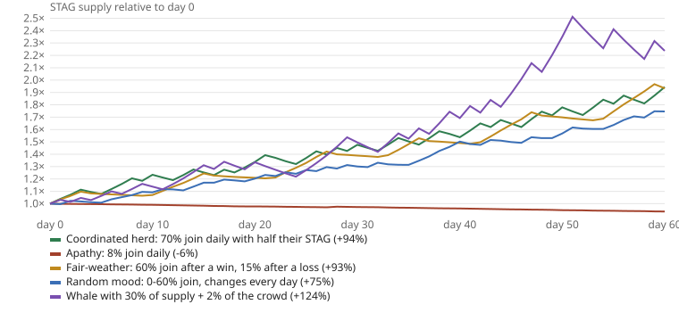

# STAG: the stag hunt coin

STAG is a NEP-141 memecoin on NEAR whose supply follows a repeated
[stag hunt](https://en.wikipedia.org/wiki/Stag_hunt), the classic coordination game.
Every round, holders can lock STAG into a "hunt". If enough of the community locks
together, every hunter gets a bonus, newly minted. If not, every hunter loses a slice,
which is burned. Supply grows when the community coordinates and shrinks when it
doesn't. The whole mechanic lives in one contract with no owner, no admin method and
no backend.

Built at NEAR HACKATHON (November 2026) for the **Memecoins With Mechanics** track
(`memecoins`). Testnet only: STAG has no value.

- Live page (testnet): https://christu117.github.io/staghunt/
- Contract: [`staghunt.testnet`](https://testnet.nearblocks.io/address/staghunt.testnet)
- The same author's other, independent hackathon project: **Satchel**, membership
  NFTs that are real NEAR accounts (`nfts` track), https://github.com/ChrisTu117/satchel.
  The two share no code or contracts.

## The problem

Most memecoins are a fixed supply and a chart: the "community" has nothing to do but
buy or sell. STAG gives the community a job with real stakes. Each hunt is a public
bet that enough holders will commit at the same time. It is a Schelling game: you win
only if the others show up, and you can see the pot fill in real time. The token's
supply becomes a running score of how well its community coordinates.

## Try it in 2 minutes (no wallet needed)

On the live page (or `npm run serve` and open http://localhost:8080):

1. Click **Create a testnet account**. The page asks the public testnet faucet for a
   throwaway account (10 testnet NEAR). Its key stays in your browser.
   You see the account name and a 0 STAG balance.
2. Click **Get 100 starter STAG**. Your balance shows 100 STAG; total supply grows by 100.
3. Enter 50 and click **Join hunt #N**. The pot shows your 50 STAG and the page says
   whether the hunt would succeed if it closed now. Alone it would not: a hunt needs
   3 hunters.
4. Click **Hunt with 2 helper accounts**. The page creates two sub-accounts of your
   account (0.3 testnet NEAR each), claims their starter STAG and joins with it. The
   hunt now shows 3/3 hunters and "would succeed".
5. Wait for the countdown (hunts last 2 minutes on testnet). The page shows
   "Hunt #N succeeded: 50 came back as 55", the supply grew, and a row appears under
   **Closed hunts** with the amount minted.
6. Join the next hunt alone. When it closes you see "failed: 50 came back as 47.50"
   and the burned amount.

Every action is a normal signed transaction with an explorer link.

## Run the checks yourself

| Command | What it does | Time |
|---|---|---|
| `cargo test -p staghunt` | 20 unit tests of the rules, including a 300+ step cross-check against an independent Python model and a random-play supply invariant | ~4 min |
| `cargo test -p staghunt-integration-tests` | runs `res/staghunt.wasm` in a local NEAR sandbox node: real receipts, real block time | <1 min after a first build of several minutes |
| `npm install && npm run demo` | end-to-end on **testnet**: deploys a fresh copy with 30-second hunts, three hunters win one hunt and lose one, 14 checks | ~2 min |
| `npm run check:abi` | the contract has no admin method; `new` is private | 1 s |
| `npm run check:live` | the deployed `staghunt.testnet` runs exactly `res/staghunt.wasm` with `deploy/testnet.json` | 3 s |
| `python3 sim/crosscheck.py --check` | the cross-check data is regenerated byte-for-byte from the Python model | 1 s |
| `python3 sim/scenarios.py` | 60 daily hunts under five behaviours; writes `sim/scenarios.md` and `docs/sim.svg` | 1 s |

Requirements: Rust 1.95+ with the `wasm32-unknown-unknown` target for the tests,
[cargo-near](https://github.com/near/cargo-near) to rebuild the wasm (`scripts/build.sh`;
a prebuilt copy is committed in `res/`), Node 20+, Python 3.

`npm run demo` takes one account from the public testnet faucet, which limits accounts
per IP address and day. If it answers 429, run it with your own testnet account:
`SPONSOR=you.testnet npm run demo` (it reads the key that `near` CLI stored in
`~/.near-credentials/testnet/`, and deletes the demo accounts afterwards so the NEAR
comes back).

## The rules

All parameters are set once in `new` and readable with `get_config`.

| | Live testnet (`deploy/testnet.json`) | Proposed for mainnet (`sim/`) |
|---|---|---|
| Hunt length | 2 minutes | 1 day |
| Bonus on success | +10% of each stake, minted | +10% |
| Loss on failure | -5% of each stake, burned | -5% |
| Target: share of total supply the pot must reach | starts at 10% | starts at 20% |
| Target after a success / failure or empty hunt | +5 points / -5 points | same |
| Target bounds | 1% to 60% | 5% to 60% |
| Minimum distinct hunters | 3 | 3 |
| Starter faucet | 100 STAG once per account, until 2026-12-31 | none (launch through a launchpad) |

1. During a hunt anyone holding STAG can lock some with `join_hunt` (1 yoctoNEAR
   attached, like `ft_transfer`). Locked STAG cannot move until the hunt closes.
   Joining twice adds to your stake.
2. When the hunt closes it **succeeds** if the pot is at least `target` of all STAG in
   existence at that moment and at least `min_hunters` accounts joined. Every hunter
   gets their stake back plus the bonus. Otherwise it **fails** and every hunter gets
   their stake back minus the burn.
3. The target moves after every hunt and stays within its bounds. A hunt nobody joins
   lowers it like a failure.
4. The contract tracks a win streak and the best streak, shown on the page.

The tension: committing early makes success likelier but risks a burn if others don't
follow. Not committing is safe but misses the bonus, and every success makes the next
target harder.

## How it works on NEAR

- **NEP-141 + NEP-145 + NEP-148** via `near-contract-standards`, with STAG-specific
  `ft_transfer` / `ft_balance_of` wrappers. Wallets and indexers see standard
  `ft_mint`, `ft_burn` and `ft_transfer` events (NEP-297) for every stake, bonus and
  burn, plus `staghunt` events `hunt_joined` and `hunt_settled`.
- **No keeper, no cron, no backend.** Settlement is lazy: the first state-changing call
  of any kind after a hunt closes settles it before doing anything else, so the result
  depends only on what happened inside the hunt. View methods run the same settlement
  code on a copy, so balances, supply and history are correct the moment a hunt
  closes, even if nobody has sent a transaction since (`src/lib.rs`, `settle_ledger`).
- **Exact accounting.** Bonuses and burns are rounded per account. The contract adds up
  each hunter's rounded bonus and burn as stakes come in, so the supply change at
  settlement equals the sum of what hunters later collect, to the last base unit. The
  sum of all `ft_balance_of` always equals `ft_total_supply`.
- **No admin.** `new` is `#[private]` (only the contract account can call it, in the
  deploy transaction). No method changes the parameters, mints outside the rules or
  upgrades the code. The live contract account `staghunt.testnet` has no access keys
  at all (deleted on 2026-11-09), so nobody can redeploy or change it;
  `npm run check:live -- --locked` verifies this.
- **Low cost for the user.** Joining a hunt is one transaction; collecting a result
  needs none (it happens inside your next transaction).

## Claims and how each is checked

| Claim | Check |
|---|---|
| Success mints exactly +10% of each stake; failure burns exactly 5% | unit `successful_hunt_mints_ten_percent`, `short_hunt_burns_five_percent`; sandbox `hunts_on_a_real_node`; `npm run demo` |
| A hunt with fewer than 3 hunters fails even with a big enough pot | unit `whale_alone_fails`; `npm run demo` step 4 |
| The target rises 5 points after a win, falls 5 points after a loss or empty hunt, stays within bounds | unit `empty_rounds_lower_target_to_floor`, `target_capped_at_max`, `successful_hunt_…`, `short_hunt_…` |
| Only what happened inside a hunt counts (a mint after the close cannot change it) | unit `late_mint_does_not_change_closed_round` |
| Balances, supply and history are right before anyone settles | unit `views_match_settled_state`; sandbox test reads balances right after the close |
| Sum of balances always equals total supply | unit `supply_invariant_under_random_play` (4 × 200 random steps) |
| Rounding is per account and exact | unit `per_account_rounding_is_exact` |
| An independent implementation agrees on 300+ random operations | unit `crosscheck_with_python_model` + `python3 sim/crosscheck.py --check` (the Python model settles eagerly; the contract lazily; no shared code) |
| Locked STAG cannot move; STAG cannot be sent to the contract outside `join_hunt` | unit `stake_is_locked`, `cannot_transfer_to_contract`; sandbox `hunts_on_a_real_node` |
| Starter faucet: once per account, closes on its date | unit `faucet_*` tests; sandbox second claim fails |
| Nobody else can initialize the contract | sandbox `nobody_else_can_initialize` |
| No admin method exists | `npm run check:abi` |
| The live contract is this code with these parameters | `npm run check:live` |

## Simulation: why these parameters

`python3 sim/scenarios.py` runs 60 daily hunts with 100 holders (1,000 STAG each)
under five behaviours, using the reference model in `sim/staghunt_sim.py`:

| Scenario | Won | Lost | Supply after 60 days | Target at the end | Best streak |
|---|---:|---:|---:|---:|---:|
| Coordinated herd: 70% join daily with half their STAG | 32 | 28 | +94.4% | 40% | 3 |
| Apathy: 8% join daily | 1 | 59 | -6.4% | 5% | 1 |
| Fair-weather: 60% join after a win, 15% after a loss | 31 | 29 | +93.3% | 30% | 6 |
| Random mood: 0-60% join, changes every day | 29 | 30 | +74.6% | 15% | 5 |
| Whale with 30% of supply + 2% of the crowd | 32 | 28 | +123.7% | 35% | 5 |



What it shows: the adaptive target settles near the share of supply the community
actually commits, so an active community wins about half the time and supply grows
steadily; an inactive one slowly burns. Wins are worth twice a loss per staked STAG,
which keeps coordination worth trying.

## Known limits

- **Whales.** Stakes are weighted by amount. A holder with more than the current target
  share can win with two companion accounts (which may be their own). The target then
  climbs 5 points per win until it passes that holder's share, but the simulation
  above shows a 30% holder more than doubling supply in 60 days, mostly into their own
  balance. Fixing this needs proof of personhood, which is out of scope.
- **Sybil accounts.** `min_hunters` counts accounts, so it is cheap to fake. It stops a
  single account from winning alone, nothing more. The token-weighted target is
  sybil-neutral: splitting STAG across accounts changes nothing.
- **Testnet parameters** differ from the proposed mainnet ones (2-minute hunts, 1%
  floor) so that a judge can see a full hunt in a few minutes and win it with two
  helper accounts while the shared supply grows.
- **Starter faucet.** Anyone can create many testnet accounts and claim 100 STAG with
  each. Fine for a demo; a real launch would distribute through a launchpad such as
  meme.cooking and set no faucet.
- **Lazy settlement** means the `hunt_settled` event is emitted by the first
  transaction after a close, not at the exact closing second. The result does not
  depend on when that happens.

## Repository layout

```
src/lib.rs                  the contract (rules, settlement, NEP-141 wrappers)
src/tests.rs                unit tests (near-sdk mocked blockchain)
integration-tests/          sandbox tests against res/staghunt.wasm
res/                        built wasm + ABI (scripts/build.sh)
sim/                        Python reference model, cross-check data, 60-day scenarios
web/src/                    page source (plain JS + near-api-js), bundled to docs/
docs/                       the static page served by GitHub Pages
scripts/                    testnet demo, ABI check, live check, build
deploy/testnet.json         parameters of the live deployment
```

## Tools and libraries

Written with **Claude Code** (Anthropic's AI coding agent): the contract, tests,
scripts and page were AI-generated and checked by the tests above. Libraries:
`near-sdk` 5.30.1, `near-contract-standards` 5.30.1, `cargo-near` 0.23.0,
`near-sandbox` 0.4.0, `near-api` 0.8 (Rust tests), `near-api-js` 7.4.0 (page and
scripts), `esbuild` 0.25 (bundling), Python 3 standard library (model and simulation).
All code was written during the hackathon (November 2026); there is no earlier
baseline.

## License

MIT, see [LICENSE](LICENSE).
