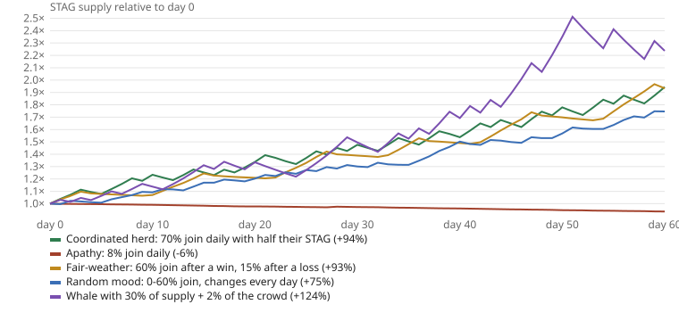

# 60 daily hunts, five behaviours

Generated by `python3 sim/scenarios.py` with the reference model (`sim/staghunt_sim.py`), 100 holders starting with 1,000 STAG each, mainnet parameters (+10% / -5%, target 20% start, +/-5 points, 5%-60%, 3 hunters minimum).

| Scenario | Won | Lost | Supply after 60 days | Target at the end | Best streak |
|---|---:|---:|---:|---:|---:|
| Coordinated herd: 70% join daily with half their STAG | 32 | 28 | +94.4% | 40% | 3 |
| Apathy: 8% join daily | 1 | 59 | -6.4% | 5% | 1 |
| Fair-weather: 60% join after a win, 15% after a loss | 31 | 29 | +93.3% | 30% | 6 |
| Random mood: 0-60% join, changes every day | 29 | 30 | +74.6% | 15% | 5 |
| Whale with 30% of supply + 2% of the crowd | 32 | 28 | +123.7% | 35% | 5 |

